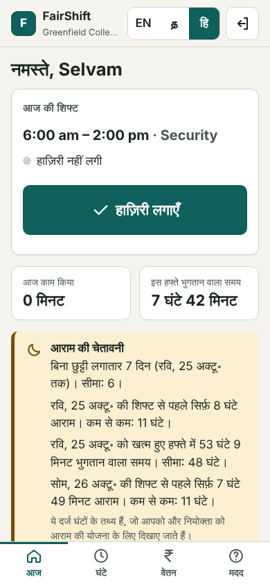
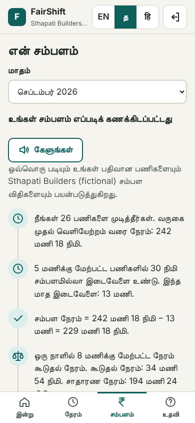
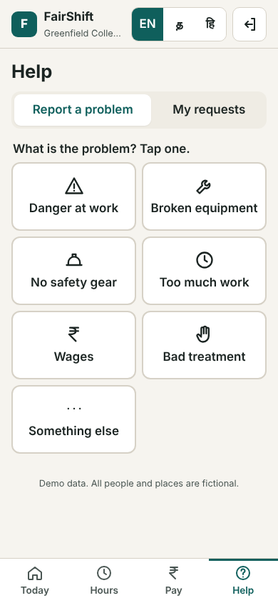
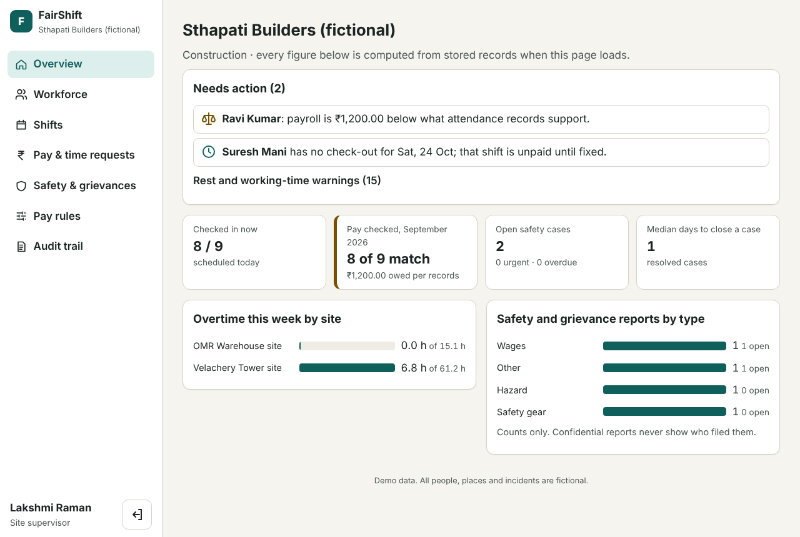
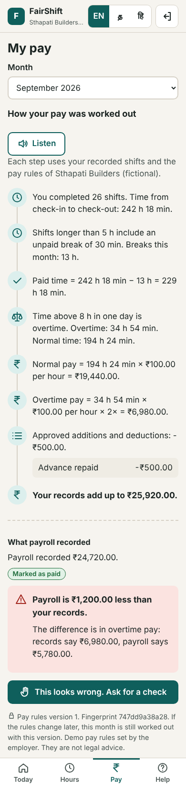

# FairShift

**Every hour explained, every concern heard, every action on record.**

FairShift is a web platform for workplaces with many hourly and shift workers, such as construction sites and college facilities teams. It links three things that usually live in separate registers, spreadsheets and WhatsApp groups:

1. **Attendance**: phone check-in and check-out, shifts, missed check-outs and fixes.
2. **Pay**: a worker can see, step by step, how their pay should be worked out from their own shifts, and where payroll differs.
3. **Safety and grievances**: workers report problems by name or confidentially, track the response, and employers act on a clock that is audited.

It was built for Prompt Wars 2026 against **UN Sustainable Development Goal 8: decent work and economic growth** (targets 8.5 and 8.8). See [docs/SDG_IMPACT.md](docs/SDG_IMPACT.md).

**Live demo: https://fairshift-0hxi.onrender.com** (free hosting: the first visit after a quiet spell can take up to a minute while the server wakes, and the demo data starts fresh each time).

> All people, organisations, places and incidents in the demo are fictional. Pay rules are demo values set by a fictional employer, not legal advice.

<p>
  
  
  
</p>
<p>
  
</p>

## Why it exists

Hourly and shift workers often cannot check their own pay. Attendance is kept on paper or in a supervisor's phone, overtime rules sit in a document nobody reads, and when the payslip looks wrong the only route is to ask the same supervisor who keeps the records. Safety problems and grievances follow the same path, so many are never raised. Employers, for their part, cannot easily see where their own records disagree, which shifts were never closed, or which reports have been waiting too long.

FairShift does not add a new judgement on top of this. It makes the existing records **explainable to the worker** and **accountable for the employer**.

## What makes it different



**Fairness Replay.** The pay engine does not just output a number. It produces an ordered trace of every step (recorded time, unpaid breaks, payable time, the overtime split, base pay, overtime pay, night allowance, approved adjustments, expected gross), each with its inputs and output. The worker screen renders that trace as plain sentences in English, Tamil or Hindi, then compares the result with what payroll recorded and names the component that differs. If it looks wrong, one tap opens a correction request that the employer must answer with a written outcome. A correction creates a **new payroll version**; the old one is kept.

Around it:

- **Versioned pay rules.** Each month is replayed with the rule version in force for that month, shown with a fingerprint. New rules can only apply from the current month onward.
- **Tamper-evident audit trail.** Every action is appended to a SHA-256 hash chain per organisation, and the employer console can verify it end to end.
- **Confidential reports that store no identity.** No account, no reporter id, no exact time; a tracking code is shown once and only its hash is kept. Details and limits are in [docs/SECURITY_PRIVACY.md](docs/SECURITY_PRIVACY.md).
- **Facts, not scores.** Long shifts, short rest, weekly hours over the limit and consecutive days are shown as dated facts to both sides. Workers are never ranked or scored.

<br clear="right">

## Who it is for

The same code serves both demo organisations; only the configuration differs. See [docs/INDUSTRY_USE_CASES.md](docs/INDUSTRY_USE_CASES.md).

| | Sthapati Builders (construction) | Greenfield College (facilities) |
| --- | --- | --- |
| Pay basis | Hourly rate per worker | Monthly salary, prorated by days |
| Overtime | Over 8 h in a day, 2× | Over 48 h in an ISO week, 1.5× |
| Breaks | 30 min unpaid after 5 h | 30 min unpaid after 6 h |
| Extras | | Night-shift allowance |
| Units | Two sites | Security, Housekeeping, Maintenance |
| Demo story | A worker underpaid ₹1,200 overtime; a missed check-out | A confidential safety report; a rotating night guard |

## What works

Everything below is implemented and covered by an automated test (file in brackets).

| Feature | Evidence |
| --- | --- |
| Pay replay with step trace, decimal-safe money in integer paise, time-zone-correct days, overnight shifts, daily and weekly overtime across month boundaries, prorated salary | 16 cases in [tests/unit/payEngine.test.ts](tests/unit/payEngine.test.ts) |
| Payroll comparison that names the differing component | `comparePay` in [tests/unit/payEngine.test.ts](tests/unit/payEngine.test.ts) |
| Pay correction workflow: request, review, written outcome, new payroll version, reopen | [tests/api/fairnessReplay.test.ts](tests/api/fairnessReplay.test.ts), Journey A in [tests/e2e/journeys.spec.ts](tests/e2e/journeys.spec.ts) |
| Phone check-in and check-out, duplicate and orphan handling, missed check-out fix | [tests/api/fairnessReplay.test.ts](tests/api/fairnessReplay.test.ts), Journey C |
| Shift assignment with overlap check | [tests/api/fairnessReplay.test.ts](tests/api/fairnessReplay.test.ts) |
| Versioned pay rules, no retroactive change | [tests/api/fairnessReplay.test.ts](tests/api/fairnessReplay.test.ts) |
| Confidential report with tracking code, no identity stored, small-site withholding and warning | [tests/api/privacyAndSecurity.test.ts](tests/api/privacyAndSecurity.test.ts), Journey B |
| Safety case state machine: no skipped states, public and internal employer notes, reopen by code | [tests/api/privacyAndSecurity.test.ts](tests/api/privacyAndSecurity.test.ts), Journey B |
| Hash-chained audit log that detects a row edited in the database | [tests/api/privacyAndSecurity.test.ts](tests/api/privacyAndSecurity.test.ts) |
| Role and organisation isolation, signed sessions, login rate limits, JSON-only mutations, security headers | [tests/api/privacyAndSecurity.test.ts](tests/api/privacyAndSecurity.test.ts) |
| Rest and working-time facts | [tests/unit/fatigueAndTime.test.ts](tests/unit/fatigueAndTime.test.ts) |
| English, Tamil and Hindi interface that follows the worker to a new phone; read-aloud using the device's voices | Journey C, [tests/e2e/accessibility.spec.ts](tests/e2e/accessibility.spec.ts) |
| WCAG 2.1 AA checks (axe-core) on every worker, public and employer screen, in all three languages and in dark mode, and no horizontal scroll at 360 px | [tests/e2e/accessibility.spec.ts](tests/e2e/accessibility.spec.ts) |
| Keyboard-only report filing | Journey C |

Current results: **42 unit and API tests and 19 browser tests pass**, typecheck is clean, and `npm audit` reports 0 vulnerabilities. Details and measured response times are in [docs/EVALUATION.md](docs/EVALUATION.md).

## How it works

```
React + Vite (phone-first worker app, employer console, public report pages)
        │  JSON over HTTPS, httpOnly SameSite=Strict session cookie
Express 5 API ── zod validation ── role and organisation checks
        │
Services (attendance, corrections, safety, insights)
        │
Pure domain code: pay engine, attendance sessions, fatigue facts, audit hash chain
        │
SQLite (node:sqlite), append-only attendance events and audit log
```

The pay engine ([src/server/domain/payEngine.ts](src/server/domain/payEngine.ts)) is a pure function with no database access, which is why it is easy to test case by case. Diagrams, data model and the algorithm are in [docs/ARCHITECTURE.md](docs/ARCHITECTURE.md).

Primary files:

- [src/server/domain/payEngine.ts](src/server/domain/payEngine.ts): Fairness Replay engine
- [src/server/domain/attendance.ts](src/server/domain/attendance.ts): events to work sessions
- [src/server/domain/auditChain.ts](src/server/domain/auditChain.ts): hash chain
- [src/server/services/safety.ts](src/server/services/safety.ts): confidential reports and case states
- [src/server/services/corrections.ts](src/server/services/corrections.ts): pay and attendance corrections
- [src/web/pages/worker/FairnessReplay.tsx](src/web/pages/worker/FairnessReplay.tsx): the replay screen

## Run it

Requires Node.js 22.12 or later. No database server or API keys are needed.

```bash
npm install
npm run build
npm start            # http://localhost:8080
```

For development with hot reload: `npm run dev` (API on 8080, Vite on 5173).

The database is in memory by default and is reseeded on every start, with demo data placed relative to today's date. Settings are in [.env.example](.env.example).

### Demo accounts

The sign-in page has one-tap buttons for each. The password for all is `fairshift-demo`.

| Username | Who | Try |
| --- | --- | --- |
| `ravi` | Construction mason | Pay tab: the ₹1,200 shortfall, then "Ask for a check" |
| `suresh` | Construction helper | Hours tab: fix a missed check-out |
| `lakshmi` | Construction site supervisor (employer) | Pay & time requests, audit trail |
| `selvam` | College night guard | Hindi, check in, rest warnings, urgent report |
| `priya` | College housekeeping | File a confidential report |
| `anita` | College facilities manager (employer) | Safety & grievances |

Public pages need no account: `/report/STHAPATI` or `/report/GREENFIELD` to report confidentially, and `/track` to follow a report. Seeded tracking codes such as `DEMO-CLGE-0001` work on `/track`.

A full walkthrough is in [docs/DEMO_GUIDE.md](docs/DEMO_GUIDE.md).

## Test it

```bash
npm test             # 42 unit and API tests (Vitest + Supertest)
npm run typecheck
npm run test:e2e     # 19 browser tests with axe-core (Playwright, Chromium)
```

GitHub Actions runs all of these on every push ([.github/workflows/ci.yml](.github/workflows/ci.yml)).

## Deploy

### Render (used for the live demo)

[render.yaml](render.yaml) is a Render Blueprint: in the Render dashboard choose **New Blueprint Instance**, pick this repository and apply. It builds the same Dockerfile and generates `SESSION_SECRET` for you.

### Google Cloud Run

The [Dockerfile](Dockerfile) builds the client and server, then runs production dependencies only as the unprivileged `node` user.

```bash
gcloud services enable run.googleapis.com cloudbuild.googleapis.com artifactregistry.googleapis.com secretmanager.googleapis.com
openssl rand -hex 32 | gcloud secrets create fairshift-session-secret --data-file=-
gcloud run deploy fairshift --source . --region asia-south1 \
  --allow-unauthenticated --max-instances 1 \
  --set-env-vars NODE_ENV=production \
  --set-secrets SESSION_SECRET=fairshift-session-secret:latest
```

`--max-instances 1` matters: the demo database lives in the container's memory, so every request must reach the same instance. When the service scales to zero, the demo resets to fresh seed data. The Cloud Run service account needs the Secret Manager Secret Accessor role on that secret. No secret is stored in this repository.

## Limitations

- **Prototype, not production.** The in-memory SQLite database is reset on restart. A real deployment needs a managed database (for example Cloud SQL), backups and migrations.
- **Not legal advice.** Overtime thresholds, rates and break rules are configurable demo values. FairShift does not certify compliance with any labour law.
- **Translations.** Tamil and Hindi strings were drafted with AI assistance and have not yet been reviewed by native speakers. See [docs/LOCALISATION.md](docs/LOCALISATION.md).
- **Read-aloud** uses the voices installed on the device; if none exists for the language, the app says so instead of reading in the wrong language.
- **Confidentiality has limits** that are stated in the app and in [docs/SECURITY_PRIVACY.md](docs/SECURITY_PRIVACY.md): the text of a report can identify the reporter, and the hosting platform's request logs record IP addresses.
- **Attendance trust.** Check-in is by signed-in phone; there is no GPS or biometric verification, by design (see privacy doc), so a supervisor can still confirm presence in person.
- **Synthetic data.** All demo records are generated by [src/server/db/seed.ts](src/server/db/seed.ts). Nothing has been tested with real workers yet.

## Documentation

- [Architecture](docs/ARCHITECTURE.md)
- [Security and privacy](docs/SECURITY_PRIVACY.md)
- [SDG 8 impact](docs/SDG_IMPACT.md)
- [Industry use cases](docs/INDUSTRY_USE_CASES.md)
- [Evaluation](docs/EVALUATION.md)
- [Localisation](docs/LOCALISATION.md)
- [Demo guide](docs/DEMO_GUIDE.md)

## License

[MIT](LICENSE)
