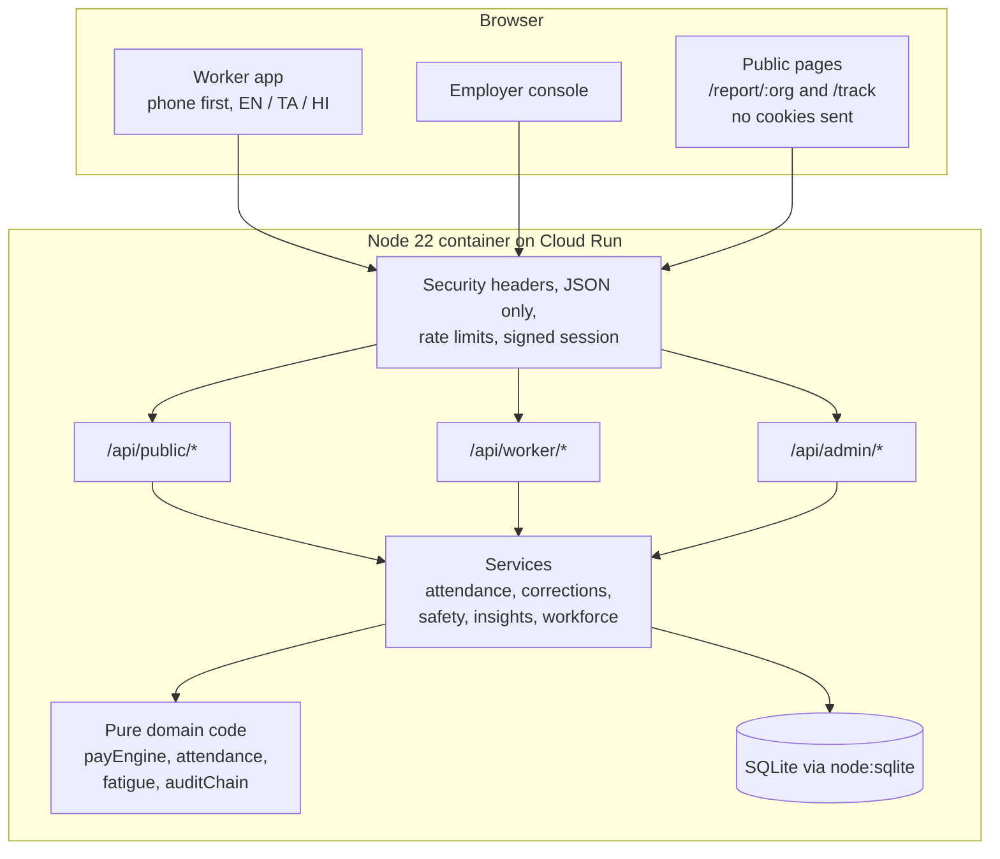
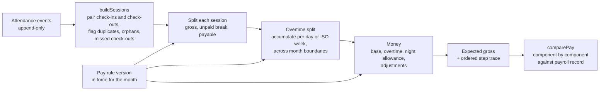
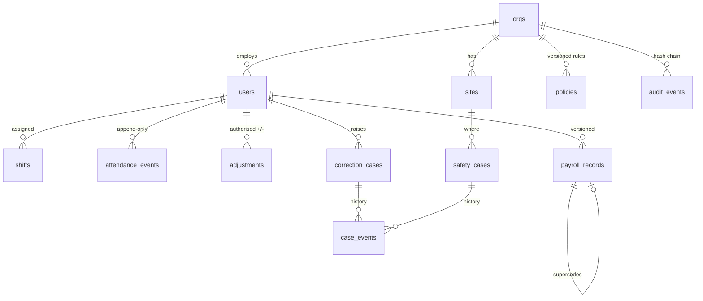

# Architecture

FairShift is a single Node.js service that serves a React single-page app and a JSON API from one container. It is small on purpose: one process, one database file (or memory), no external services and no API keys.

## Components

The public report routes are mounted **before** the session middleware, so they never read a session cookie even if one is sent, and the client calls them with `credentials: 'omit'` so the browser does not send one.

## Layers

| Layer | Folder | Rule |
| --- | --- | --- |
| Shared | `src/shared` | Money in integer paise, time-zone helpers, types used by both server and client. |
| Domain | `src/server/domain` | Pure functions. No database, no clock (the current time is passed in). This is where the pay rules live. |
| Services | `src/server/services` | Read and write the database inside transactions, call the domain, append audit entries. Every query is scoped by organisation id. |
| HTTP | `src/server/http` | Validation with zod, role checks, error mapping. No business rules. |
| Web | `src/web` | React. Shows what the API returns. The pay explanation is built from the engine's own steps, not recalculated in the browser. |

## Fairness Replay pipeline

Details that matter for correctness:

- **Money** is integer paise. Rates are paise per hour and multipliers are basis points (10000 = 1×). Division happens once per component through `divRound`, which rounds half away from zero. There is no floating-point money anywhere. ([src/shared/money.ts](../src/shared/money.ts))
- **Days** are decided in the organisation's time zone (Asia/Kolkata in the demo), never in UTC. A shift that crosses midnight belongs to the day it started, and earns the night allowance where the rules have one.
- **Overtime across months.** Weekly overtime uses ISO weeks. All sessions, not only those in the month, are fed into the accumulation, so a week that starts in September and ends in October is still one week. Only the sessions dated in the month are then counted for that month's pay.
- **Missed check-outs** are excluded from pay and reported as issues, so the worker sees "this shift is unpaid until fixed" instead of a silently wrong total. A shift still open within the policy's limit is "in progress", not missed.
- **Corrections never edit history.** An approved attendance fix appends a `void` event and a new event. An approved pay fix inserts a new payroll version that points to the one it supersedes.
- **Monthly salaries** are prorated by calendar days employed, and counted up to today while the month is still running. Overtime on a salary uses salary ÷ standard monthly hours as the hourly equivalent, kept as a fraction until the final rounding.

The engine returns a `steps` array (`recorded_time`, `unpaid_breaks`, `payable_time`, `overtime_split`, `base_pay`, `overtime_pay`, `night_allowance`, `adjustments`, `expected_gross`), each with the rule text, inputs and output. The worker screen turns each step into one translated sentence filled with that step's numbers ([src/web/pages/worker/FairnessReplay.tsx](../src/web/pages/worker/FairnessReplay.tsx)).

## Data model

Constraints enforced by the database itself ([src/server/db/schema.ts](../src/server/db/schema.ts)):

- `payroll_records`: `gross_paise = base + overtime + night allowance + adjustments`.
- `safety_cases`: a confidential row must have no reporter id, no exact creation time and a tracking hash.
- `shifts`: end after start. Enumerations for roles, statuses and event kinds are `CHECK` constraints.

## Pay rule versions

Each organisation's rules are stored as JSON with a version number and an `effective_period` (a month). The engine uses the latest version whose effective month is on or before the month being replayed. The API refuses a new version that starts before the current month, so last month's explanation cannot change after the fact. The screen shows the version and the first 12 characters of the SHA-256 of the canonical rule JSON.

## Audit chain

Every state change appends a row to `audit_events` inside the same transaction. Each row stores `hash = SHA-256(prev_hash | org | seq | time | actor | action | entity | id | canonical JSON details)`. `GET /api/admin/audit/verify` recomputes the chain and reports the first broken sequence number.

This detects edits or deletions made without recomputing the chain. Someone with full write access to the database could rewrite the whole chain, so in a real deployment the head hash shown by the verify screen should be copied somewhere the operator does not control (for example, emailed to worker representatives each month).

## Requests and sessions

- Session: HMAC-SHA256 signed cookie `fs_session`, `httpOnly`, `SameSite=Strict`, `Secure` in production, 12-hour expiry.
- Every mutating API call must be `application/json` (415 otherwise). Combined with `SameSite=Strict`, this blocks cross-site form posts.
- Rate limits are in memory: sign-in per client and username (10 a minute), confidential report submission per client (5 an hour), tracking-code lookups per client (30 a minute). Client keys are salted hashes of the IP that rotate daily; raw IPs are not stored.
- Cloud Run puts one proxy in front of the container, so `trust proxy` is set to exactly 1.

## Front end

- React 18 with a tiny in-house router, no state library. Vite builds about 74 KB of JavaScript and 4 KB of CSS (gzipped).
- All strings go through `t()` with English, Tamil and Hindi dictionaries that share one typed key set, so a missing translation is a type error.
- Large touch targets (48 px), a bottom tab bar on the phone, the employer console gets a sidebar from 900 px.
- Read-aloud uses the browser's `speechSynthesis` with a voice for the chosen language, if the device has one.

## Why these choices

- **node:sqlite** keeps the demo self-contained: no database server, no credentials, starts in milliseconds. The service layer only uses standard SQL, so moving to PostgreSQL is a contained change.
- **Pure domain functions** make the pay engine testable with exact numbers, and make the explanation trustworthy because the screen renders the same trace the tests check.
- **One container** fits Cloud Run's model and the competition's hosting rule.
