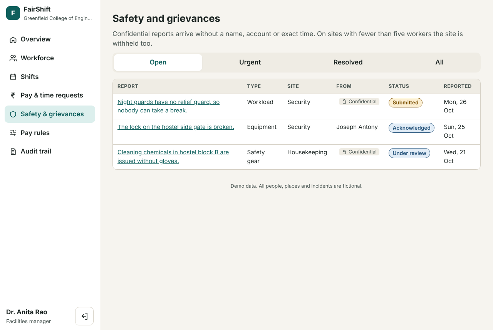

# Industry use cases

FairShift runs two fictional organisations on the same code and the same database. Nothing is special-cased by industry in the pay engine, the attendance logic or the case workflows. What differs is configuration: pay rules, pay terms, units of work and the people in them.

## Construction: Sthapati Builders (fictional)

**Context.** Daily-rated masons, helpers and electricians across two sites. Attendance was traditionally kept by a site supervisor. Overtime is common near deadlines.

| Setting | Value |
| --- | --- |
| Pay basis | Hourly, each worker at their own rate (₹90 to ₹125 an hour in the demo) |
| Overtime | Minutes beyond 8 hours in a day, at 2× |
| Unpaid break | 30 minutes on shifts longer than 5 hours |
| Missed check-out | Flagged after 16 hours open |
| Rest facts | Shift over 12 hours, rest under 10 hours, over 48 hours a week, 7th day in a row |
| Units | Velachery Tower site (7 workers), OMR Warehouse site (2 workers, a small site) |
| Report code | `STHAPATI` |

**Demo stories.**

- **Ravi Kumar, mason**: September payroll recorded ₹24,720.00, while his attendance supports ₹25,920.00. The replay shows the gap is entirely in overtime (₹6,980.00 expected vs ₹5,780.00 recorded) and lists an authorised ₹500 "Advance repaid" deduction separately so it is not mistaken for the error. He asks for a check; the supervisor reviews the shifts and records a correction, creating payroll version 2.
- **Suresh Mani, helper**: forgot to check out three days ago. The shift is shown as unpaid until fixed. He enters the time he left from his phone, and the supervisor approves it.
- **Karthik**: several shifts over 12 hours show up as rest facts on both his screen and the employer's.
- **A confidential report from the OMR Warehouse site** (two workers) about drinking water is shown to the supervisor with the site withheld. Its demo tracking code is `DEMO-CNST-0002`.

## College facilities: Greenfield College of Engineering (fictional)

**Context.** Salaried security guards on rotating shifts including nights, housekeeping staff and a small maintenance team, managed by a facilities manager.

| Setting | Value |
| --- | --- |
| Pay basis | Monthly salary (₹15,000 to ₹22,000 in the demo), prorated by calendar days employed |
| Overtime | Minutes beyond 48 hours in an ISO week, at 1.5×, using salary ÷ standard monthly hours |
| Night allowance | ₹100 for each shift that crosses midnight |
| Unpaid break | 30 minutes on shifts longer than 6 hours |
| Rest facts | Minimum rest 11 hours between shifts |
| Units | Security (5), Housekeeping (5), Maintenance (2, a small site) |
| Report code | `GREENFIELD` |

**Demo stories.**

- **Selvam, night guard** (the demo switches him to Hindi): on a rotating rota that produced seven days in a row and short rest between a night and a morning shift. Both appear as dated facts. He checks in from his phone and reports an urgent danger by tapping icons, without typing.
- **Priya, housekeeping**: reports a loose stair tile with "Keep my name out", gets a tracking code, and later reads the facilities manager's public response on `/track` without signing in.
- **Farhan, electrician**: his named report about a cracked ladder rung shows the full case history from submitted to resolved.

## What is shared

| Capability | Construction | College |
| --- | --- | --- |
| Phone check-in and check-out | Same | Same |
| Fairness Replay steps | Daily overtime, hourly base | Weekly overtime, salary base, night allowance |
| Pay correction workflow | Same | Same |
| Attendance correction | Same | Same |
| Safety and grievance categories | Same seven | Same seven |
| Confidential reports, small-site withholding | Same | Same |
| Audit chain, rule versions | Same | Same |
| Languages | EN, TA, HI | EN, TA, HI |

The test `reuses the same engine for the college: monthly salary, weekly overtime, night allowance` in [tests/api/fairnessReplay.test.ts](../tests/api/fairnessReplay.test.ts) checks this.

## Other workplaces

Any workplace with shift attendance and rule-based pay can be configured the same way. For example:

- **Warehouses and logistics**: hourly pay, weekly overtime, night allowance for late shifts.
- **Hospital support staff**: salaried, rotating shifts, minimum rest rules.
- **Hotels and catering**: split shifts as two sessions on one day, which the daily overtime rule already handles.

Features a real deployment in these settings would likely need, and which FairShift does not have yet: piece-rate pay, public-holiday rates, shift swaps, contractor and subcontractor hierarchies, and export to payroll software.
